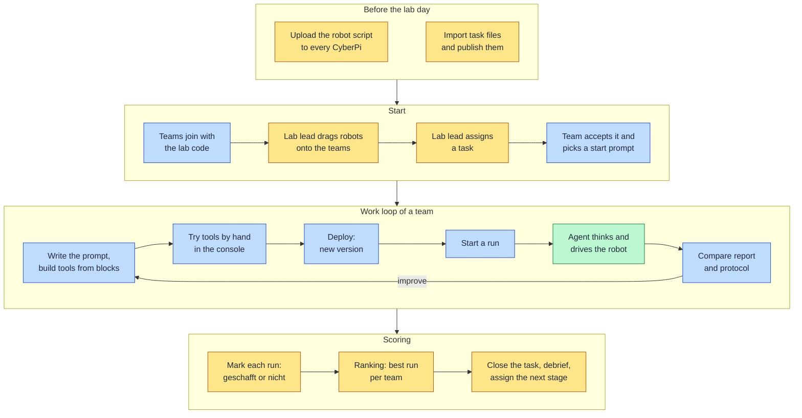
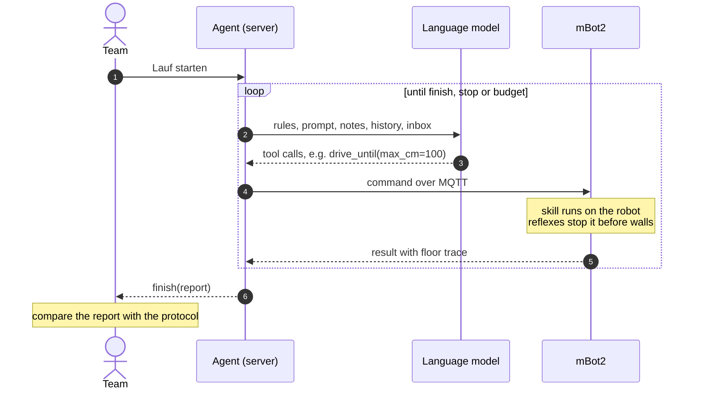
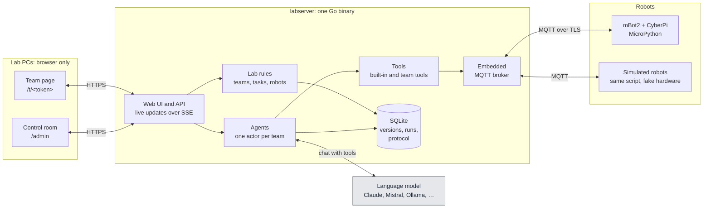

# mBot2 Agent Lab

**Teams write the prompt of an AI agent, and the agent drives a real robot.**

Each team gets one or more Makeblock mBot2 robots and an agent that runs inside the lab server.
The team never steers the robot directly during a run: it writes the agent's prompt, builds tools
from blocks, deploys, presses "Lauf starten" and watches what the agent makes of it. Students only
need a browser: no accounts, no installs, no API keys.

What they learn:

- **Instructing precisely:** the agent never sees the task text. Turning a task into a prompt is
  the job.
- **Recognising the limits of agents:** compare the agent's report with the protocol of what the
  robot really did ("Lügendetektor").
- **Designing tools:** build your own tools from blocks and decide what belongs in a tool and what
  the agent should decide.
- **Treating tokens as a cost:** every run shows its tokens and cost; the ranking rewards few
  model calls.
- **Spotting attacks:** agents of different teams talk to each other, and not everything they say
  is true.

> Repository, code and technical docs are in English. Lab material and the student-facing UI are
> in German; task files exist in both languages.

## How a lab session runs



<sub>🟨 lab lead in the control room · 🟦 team on its team page · 🟩 the team's agent</sub>

A lab day walks through a **learning path of five stages**, one task each
([guide for the lab lead](docs/lab/werkzeuge.md), German):

| Stage | Who decides | Concept |
| --- | --- | --- |
| 1. Selbst steuern | the student is the agent: run one tool by hand, read the result, choose the next | instruction, sequence, result |
| 2. Wiederholen | the student writes the repetition down as blocks | loops |
| 3. Entscheiden | the student writes the decision down as blocks | conditions, special cases |
| 4. Agent | a language model picks which tool runs when | tool, description, prompt |
| 5. Challenge | what belongs in a tool, and what does the agent decide? | big and rigid or small and flexible |

More tasks: exploring, two robots per team, a line field with colored stripes and a negotiation
between teams as a prompt-injection exercise ([all tasks](docs/lab/README.md)).

## What happens in a run

The agent sleeps until something wakes it: the start of a run, a team message, another agent or a
robot event such as a button press or tipping over. Routine readings wait in its inbox, so they do
not burn tokens. The robot keeps real-time control: a tool like "drive until the wall" runs as a
skill on the robot and reports back when it is done.



## Architecture



- **Robot** (`robot/`): one MicroPython script per robot with a non-blocking main loop. Skills such
  as `drive_until`, `turn_until_clear`, `scan` and `follow_line_until` run as state machines on the
  robot; reflexes (emergency stop, watchdog, tilt) work without the server. Decisions use filtered
  sensors, never a single raw reading. Every motion reports its floor trace.
- **Server** (`server/`): broker, robot registry, agent runtime, team tools interpreter, model
  access (any OpenAI-compatible endpoint or Claude), SQLite store and the web UI, in one binary.
- **Web** (`web/`): team page and control room (Preact, CodeMirror, Blockly), embedded into the
  server. No CDN, so it works behind corporate proxies.
- **Simulator** (`sim/`): runs the real robot script with fake hardware in a 2D world with
  realistic sensor noise and network delay. Labyrinths, an arena, a line course and the line field.

Details: [architecture](docs/architecture.md), [MQTT protocol](docs/protocol.md),
[decisions](docs/decisions.md).

## Features

**Team page** (`/t/<token>`, in the team's color, the same color as its robots' LEDs)

- Prompt editor with Markdown highlighting and tool name completion; preview; version history with
  side-by-side diffs and restore.
- Own tools ("Eigene Werkzeuge") built from blocks: repeat, if/else, return a result. The team
  runs them by hand, also step by step, and after a deploy the agent gets them as tools. The
  history compares the blocks of two versions.
- Console: every built-in tool as a form, run by hand, result with the floor trace.
- Live log of the run, a conversation with the agent between runs, notes the agent keeps across
  runs.
- Robots live, rename, "Finden" (blink and beep); tokens and cost per run; model choice.

**Control room** (`/admin`)

- Lab code and a QR code to join for the projector, every robot live, every team with its robots and open browsers.
- Robots and tasks are assigned by drag and drop; emergency stop for all robots.
- Tasks: import from a file, edit with preview, publish, assign, close. A task can limit the agent
  to the team's own tools.
- "Läufe": every run of every team with version, success, time, model calls and interventions,
  and the ranking.
- Release models for teams to choose; switch conversations off for a competition.

**Agents**

- One agent per team with an inbox; it calls the model only when woken.
- Several robots per team; tool calls for different robots run at the same time.
- Budgets for steps, tokens, minutes and messages; every model call is stored with tokens and cost.
- Messages from other agents are marked as such: the agent has to check claims.

## Getting started

No hardware needed: the simulator stands in for the robots and a scripted test model for the
language model.

```bash
npm install
```

```bash
npm run dev
```

```bash
npx nx run sim:run --robots=3 --world=sim/worlds/labyrinth.json
```

Then open the control room at http://localhost:5173/admin (password `dev`) and join a team at
http://localhost:5173/join (lab code `DEV1`).

Tests, real robots, API keys and deployment: **[developer guide](docs/development.md)**.

## Documentation

| Document | Content |
| --- | --- |
| [Developer guide](docs/development.md) | setup, Nx tasks, simulator, models and keys, real robots, deployment |
| [Architecture](docs/architecture.md) | components, robot script, server, agent runtime, web UI |
| [Decisions](docs/decisions.md) | binding decisions and approved deviations |
| [Protocol](docs/protocol.md) | MQTT messages between server and robots |
| [Tool catalog](docs/tools.md) | the agent's tools, their results and block texts |
| [Team tools](docs/programs.md) | tools built from blocks: tree, validation, interpreter |
| [Event log](docs/events.md) | events, run measures and ranking |
| [Line field](docs/field.md) | the field with colored stripes |
| [Lab material](docs/lab/README.md) | for the lab lead, German: running a lab day, tasks, learning path |

## Status

Working: the full lab loop with tasks, team tools from blocks, by-hand console, agent runs and
conversations, scoring and ranking, several robots per team, Claude and OpenAI-compatible models,
USB upload without mBlock, and the simulator with noise and network delay.

Not yet: `gesture` and `play_melody` on the robot, summaries of long runs, a run history on the
team page, a chat wall, MCP. Vendor API calls on
the robot are still being verified on hardware ([measurements](docs/measurements.md)).

## License

Apache 2.0, see [LICENSE](LICENSE).
